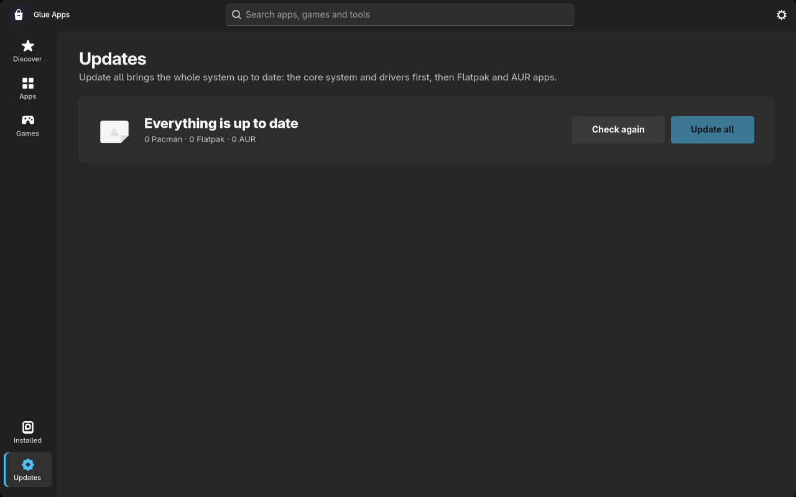
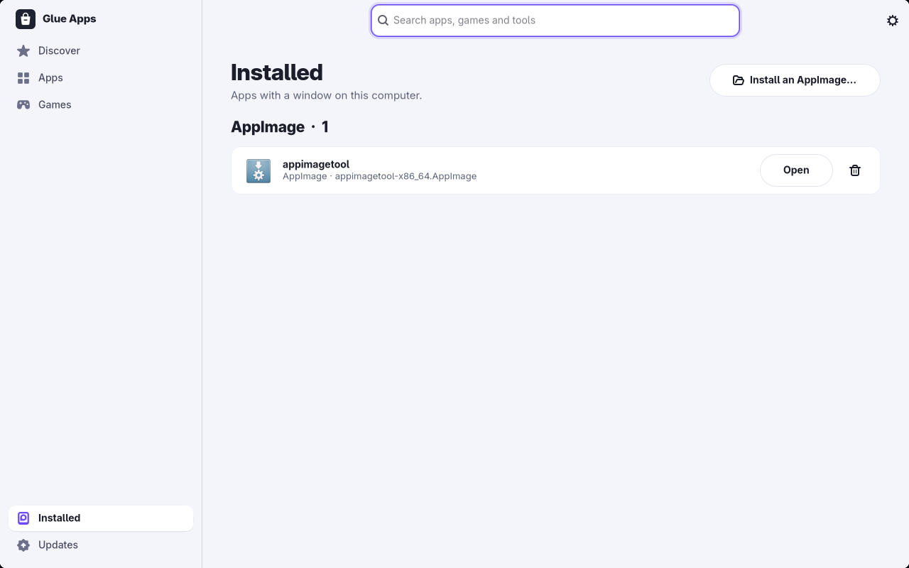

# Glue Apps

An app store for Arch Linux, CachyOS and Artix. Find an app, see where you can
get it from, install it with one click, and update the whole system from the
same window.


## What it does

- **One search for everything.** Official repositories (Pacman), Flathub
  (Flatpak) and the AUR are searched together. The same app found in several
  places shows up once.
- **Every app page shows all three sources** side by side: whether the app is
  there, the version, the download size, and its own Install button. The best
  option is marked, so you don't have to know the difference to pick one.
- **AppImages, made easy.** Click *Install an AppImage…*, drop the file on the
  window, or double-click it in your file manager. It is copied to
  `~/Applications`, gets an icon and a menu entry, and shows up under
  *Installed* with Open and Uninstall buttons.
- **Updates for the whole system.** One button runs the system upgrade first,
  then Flatpak and AUR updates. The list shows apps with a window first, then
  the packages without one (drivers, libraries, runtimes). Nothing checks in the
  background; it only looks when you open the app or press *Check again*.
- **Installed** lists every app with a window, grouped by where it came from.
- **A curated front page** with around 90 hand-picked apps in nine categories,
  including an AI section: Claude, Claude Code and Codex (AUR), Ollama
  (official repositories), LM Studio, Jan, Alpaca, GPT4All and more (Flathub).
- **Three looks**, switchable live in Settings: *Glue* (light, white cards),
  *Showcase* (light, search in the sidebar, large feature cards) and *Mosaic*
  (dark tiles with a navigation rail). The layout adapts down to half a screen.
- English by default, Romanian in Settings.

| Showcase | Mosaic |
| --- | --- |
|  |  |

| App page | Updates | Installed |
| --- | --- | --- |
|  |  |  |

## Supported systems

| | Arch Linux | CachyOS | Artix |
| --- | --- | --- | --- |
| Pacman | yes | yes | yes |
| Flatpak | yes | yes | yes |
| AUR | with `yay` or `paru` | with `yay` or `paru` (both in `[cachyos]`) | with `yay` or `paru` |
| App metadata | `archlinux-appstream-data` | `archlinux-appstream-data` | `artixlinux-appstream-data` |

Works with any init system. On systems without systemd, the AUR warning also
mentions that some recipes expect systemd.

## Install

From the AUR-style `PKGBUILD` in this repository:

```sh
git clone https://github.com/vladbiber/glue-apps.git
cd glue-apps
makepkg -si
```

Or straight from the checkout:

```sh
sudo make install
```

Runtime dependencies: `python`, `python-gobject`, `gtk4`, `libadwaita`,
`polkit`, `adwaita-fonts`, `pacman-contrib`. Optional: `flatpak`, `yay` or
`paru`, the appstream data package for your distribution, and `fuse2` (without
it AppImages still run, they are just unpacked on every start).

## How installs work

- Pacman installs and removals go through a small helper started with `pkexec`
  (`/usr/lib/glue-apps/pkg.sh`); polkit asks for the password once and keeps it
  for a few minutes.
- Flatpak apps are installed per user, no password needed.
- AUR packages are built as your user by `yay` or `paru`; only the final
  `pacman -U` step asks for the password. The first AUR install shows a short
  warning about community recipes.
- The system upgrade (`/usr/lib/glue-apps/update.sh`) refuses to run when a DKMS
  driver is installed but the headers for one of your kernels are missing, so an
  NVIDIA update can't leave you without a display driver.

## Development

```sh
sh scripts/run-dev.sh            # run from the checkout
sh scripts/run-dev.sh --page updates
make test
```

Pure logic (catalog, sources, updates, AppImage handling, settings) lives in
modules that don't import GTK and is covered by the tests in `tests/`.

## License

GPL-3.0-only. See [LICENSE](LICENSE).
